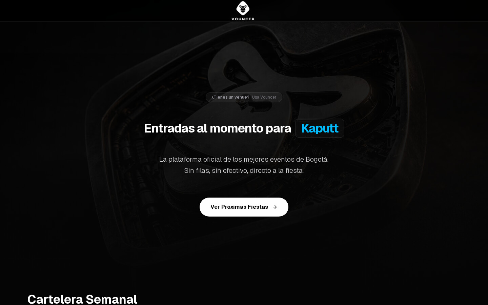
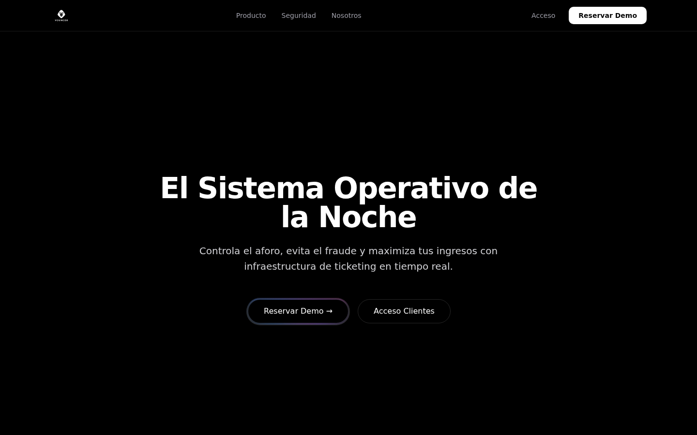

# Vouncer

Ticketing for nightclubs in Bogotá: people buy tickets for a party, get a QR by email, and the bouncer scans it at the door. Live at [vouncer.com](https://vouncer.com).



## What it is

Vouncer started in February 2026 as an MVP for selling club tickets without queues or cash. A venue publishes its events, each with several ticket types (price, number of tickets, drinks included). Customers pick an event, fill in name and email, and receive their tickets. At the door, staff open the scanner page on a phone and validate each QR once.

There are two sides to the app. The public side is the event listing, the checkout and the "mis entradas" page where a guest sees their QRs. The business side (`/business`) is a landing page for venues with a demo request form, and `/admin` is where venue staff manage events and scan tickets. The whole UI is in Spanish.

## How it works



The venue-facing landing at `/business`, with the demo request and the client login.

- Events, ticket types, tickets and profiles live in Supabase (Postgres). Row Level Security is on, so the server uses the service role key only for the two things a guest session cannot do: increment sold tickets and read tickets for a magic link.
- Checkout is a server action: it checks availability, inserts one ticket row per unit, bumps the stock (through an RPC when it exists, plain update otherwise) and sends one email with Resend.
- Guests do not need an account. The email contains a link to `/mis-entradas?ids=...` that renders the QRs for those tickets.
- Each ticket has a `qr_token`. The scan page uses the phone camera, calls `validateTicket` and marks the ticket as used, so a QR only works once.
- Login is Supabase Auth with a `role` column on `profiles`. `admin` and `owner` get the full admin area, `bouncer` only gets the scanner.
- The home page is statically generated and revalidated every minute, using a cookie-free Supabase client so ISR actually caches.
- There is no payment step at the moment. A Wompi integration was added in April 2026 and reverted; checkout creates the tickets directly.

## Stack

Next.js 16 (App Router, Turbopack), React 19, TypeScript, Tailwind CSS 4, shadcn/ui and Radix, Supabase (Postgres, Auth, Storage), Resend with React Email, `@yudiel/react-qr-scanner` and `react-qr-code`. Deployed on Vercel.

## Run it

Node 22.

```bash
npm ci
cp .env.example .env.local   # fill in the Supabase and Resend values
npm run dev                  # http://localhost:3000
npm run build                # production build
```

The build needs at least `NEXT_PUBLIC_SUPABASE_URL` and `NEXT_PUBLIC_SUPABASE_ANON_KEY`, because the home page prerenders the event list.

Database setup: run the SQL files in `supabase/` against your project. `setup_roles.sql` has the role helper and example queries, `migrations/` has the event lifecycle columns and the `increment_sold_tickets` RPC.

## Team

- Luis Molina ([34lumo](https://github.com/34lumo))
- Alejandro Piñeres
